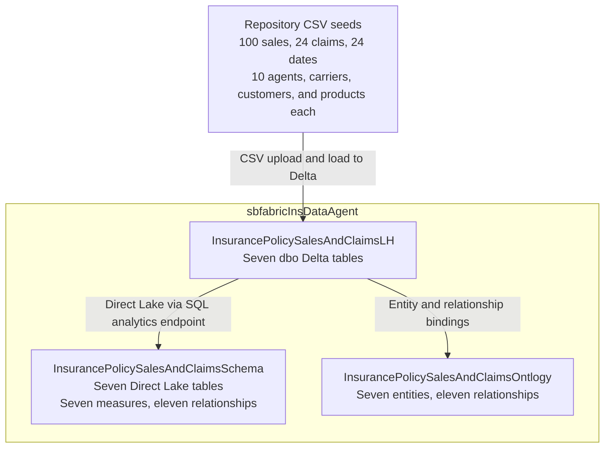
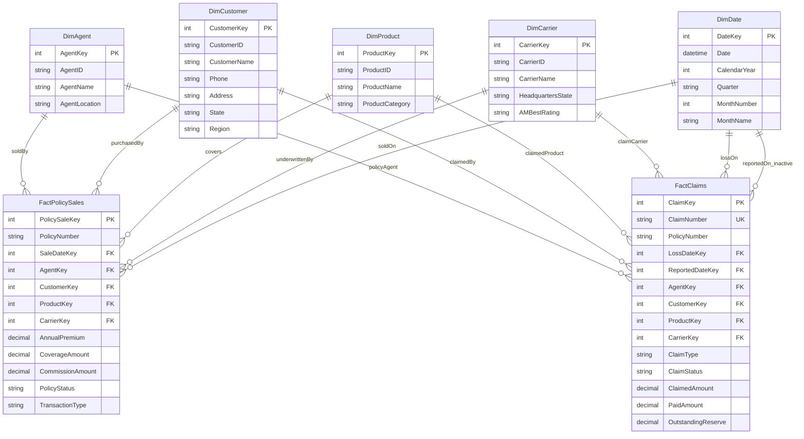

# Insurance Policy Sales and Claims Schema

## Deployed Fabric Architecture

Both Fabric items use the destination lakehouse, not each other. The ontology entities map `Agent`, `Carrier`, `Customer`, `Date`, `Product`, `PolicySale`, and `Claim` to the corresponding dimension and fact tables below. The original `sbfabiq` workspace was a read-only reference and is not a data dependency. Local CSV changes must be loaded into Fabric; Git pushes do not refresh the lakehouse or semantic model.

## Shared-Dimension Table Schema

`FactPolicySales` has one row per policy issuance or renewal transaction. `FactClaims` has one row per claim, holding its current status, cumulative paid amount, and current outstanding reserve. Update the same claim row as it develops; this is not a payment-transaction or historical snapshot fact.

Both facts reuse the five existing dimensions with one-to-many, single-direction dimension-to-fact filtering. `AgentKey` on a claim identifies the policy's selling agent, not a claims adjuster. `PolicyNumber` is a shared business identifier, not a foreign key to `FactPolicySales`: policies can have multiple sales transactions and multiple claims, so there is no direct fact-to-fact relationship.

`LossDateKey` is the active claims relationship to `DimDate.DateKey`. `ReportedDateKey` is inactive in the semantic model; activate it in a measure with `USERELATIONSHIP` when reporting by reported date. A shared date filter otherwise means sale date for premium and loss date for claims.

All monetary amounts are USD sample values. `ClaimedAmount` is the amount requested, `PaidAmount` is paid to date, and `OutstandingReserve` estimates future payments. Incurred claims equal paid plus outstanding reserve; they need not equal the amount requested. Closed and denied sample claims have zero outstanding reserve.

The CSV seeds and destination lakehouse contain 100 policy sales, 24 claims, and 10 members in each non-date dimension. [DimDate.csv](DimDate.csv) contains 24 unique dates: the 1st and 15th of each month in 2026. All policy sale, loss, and reported date keys reference those dates; there are no 2027 dates. Existing policy and claim identifiers are unchanged, including identifiers with a `27` prefix, which does not determine the date fields. The deployed semantic model reads these tables through Direct Lake. The ontology binds to the same destination lakehouse; the original `sbfabiq` resources remain unchanged.
